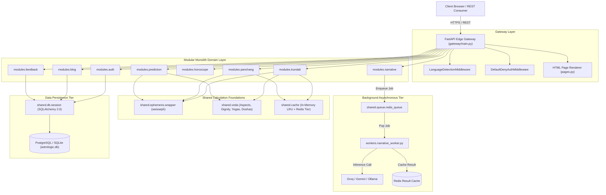
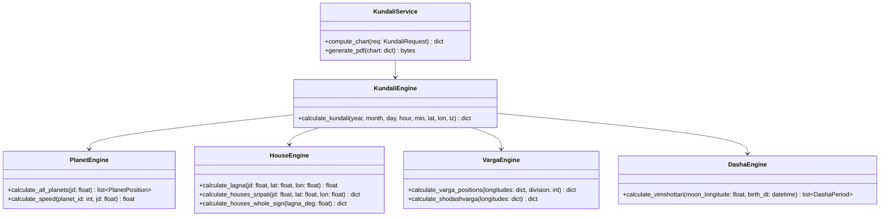
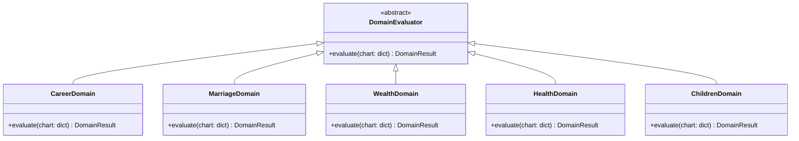
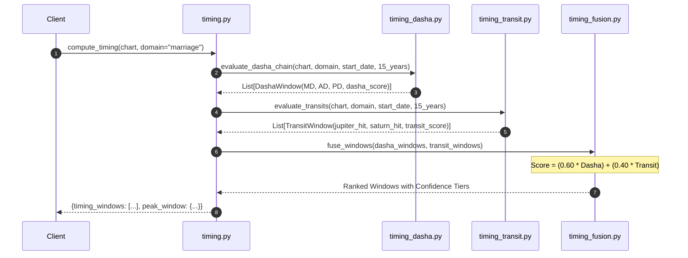
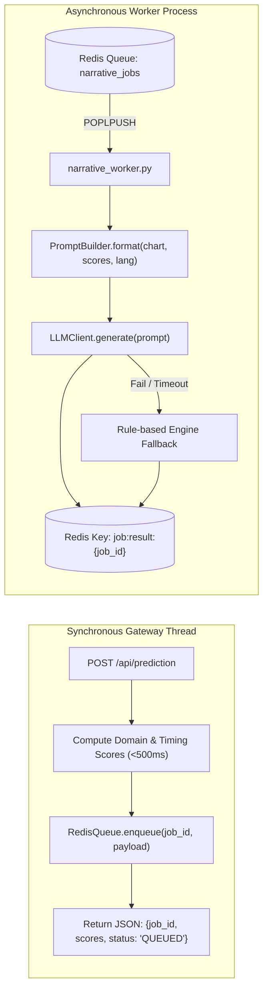
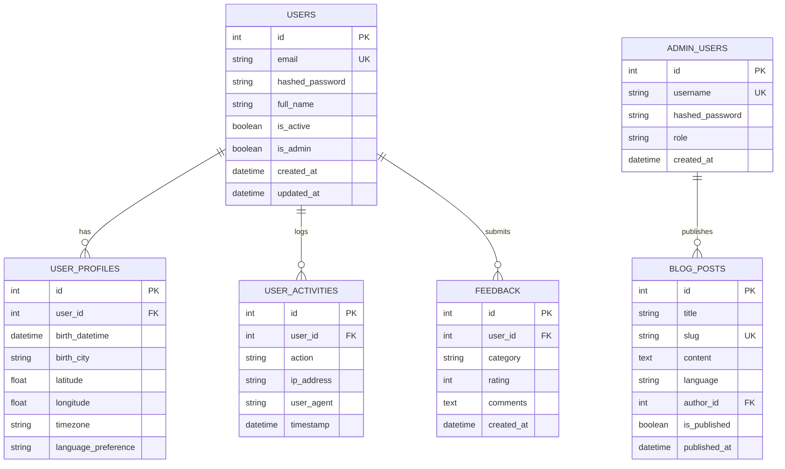

# 📐 Low-Level Design (LLD) Specification: AstroLogic AI Platform

**Document Version:** 2.1.0  
**Status:** Approved for Implementation / Architecture Baseline  
**Target Systems:** Modular Monolith (FastAPI) + Swiss Ephemeris (`swisseph`) + Redis + PostgreSQL/SQLite + Vue/Vanilla Client  
**Scope:** Complete Subsystem Design, Classes, Schemas, Algorithms, APIs, and Data Models

---

## 📑 Table of Contents
1. [System Context & Architectural Topology](#1-system-context--architectural-topology)
2. [Gateway & Edge Router Subsystem](#2-gateway--edge-router-subsystem)
3. [Core Calculation Engines & Domain Modules](#3-core-calculation-engines--domain-modules)
   - 3.1 [Kundali Engine (Astronomical Ephemeris & Shodashvarga)](#31-kundali-engine)
   - 3.2 [Panchang Engine (5-Limb Vedic Calendar & Muhurta)](#32-panchang-engine)
   - 3.3 [Prediction & 10 Life Domains Engine](#33-prediction--10-life-domains-engine)
   - 3.4 [Phase 5 Concrete Event Timing Engine (Dasha-Gochara Fusion)](#34-phase-5-concrete-event-timing-engine)
   - 3.5 [Narrative & AI LLM Asynchronous Subsystem](#35-narrative--ai-llm-asynchronous-subsystem)
   - 3.6 [Transit & Daily Horoscope Engine](#36-transit--daily-horoscope-engine)
   - 3.7 [Authentication & RBAC Subsystem](#37-authentication--rbac-subsystem)
4. [Mathematical & Astrological Algorithmic Formulations](#4-mathematical--astrological-algorithmic-formulations)
5. [Database Architecture & Entity-Relationship Model](#5-database-architecture--entity-relationship-model)
6. [API Interface Specifications & Contracts](#6-api-interface-specifications--contracts)
7. [Caching, Queuing & Concurrency Subsystem](#7-caching-queuing--concurrency-subsystem)
8. [Security, Middleware & Exception Handling](#8-security-middleware--exception-handling)
9. [Traceability Matrix & Directory Mapping](#9-traceability-matrix--directory-mapping)

---

## 1. System Context & Architectural Topology

The AstroLogic AI platform utilizes a **Modular Monolith** pattern. The backend runs as a single runtime process, organized into distinct bounded contexts. Heavy computation is decoupled from request-response threads through an asynchronous Redis task queue.

### High-Level Topology Diagram



---

## 2. Gateway & Edge Router Subsystem

### 2.1 Component Overview
The Gateway layer sits at [`backend/gateway/`](file:///c:/Desktop/astro_may_res%20(2)/astro-platform/backend/gateway/) and acts as the single ingestion and enforcement boundary.

### 2.2 Class & Component Design

#### `DefaultDenyAuthMiddleware(BaseHTTPMiddleware)`
- **File**: [`gateway/main.py`](file:///c:/Desktop/astro_may_res%20(2)/astro-platform/backend/gateway/main.py#L39-L87)
- **Purpose**: Enforces zero-trust default denial on all `/api/*` endpoints except an explicit whitelist.
- **Attributes**:
  - `PUBLIC_API_PREFIXES: tuple[str, ...]` = `("/health", "/metrics", "/api/locales", "/api/panchang", "/api/festivals", "/api/horoscope", "/api/daily-horoscope", "/api/cities", "/api/auth/login", "/api/auth/signup", "/api/auth/logout")`
- **Methods**:
  - `dispatch(request: Request, call_next) -> Response`: Evaluates session cookie `user_id`. Returns `401 Unauthorized` for non-public `/api/*` routes lacking authentication.

#### `LanguageDetectionMiddleware(BaseHTTPMiddleware)`
- **File**: [`gateway/middleware/language.py`](file:///c:/Desktop/astro_may_res%20(2)/astro-platform/backend/gateway/middleware/language.py)
- **Purpose**: Determines locale from URL prefix, cookie (`lang`), or `Accept-Language` header.
- **Methods**:
  - `resolve_request_language(request: Request) -> str`: Normalizes language to `en`, `hi`, `mr`, `gu`, `bn`, `ta`, `te`, or `kn`.

#### `PagesRouter`
- **File**: [`gateway/pages.py`](file:///c:/Desktop/astro_may_res%20(2)/astro-platform/backend/gateway/pages.py)
- **Purpose**: Serves server-side Jinja2 rendered HTML templates with injected i18n dictionaries.
- **Methods**:
  - `_render_page(request: Request, template_name: str, context: dict | None) -> HTMLResponse`

---

## 3. Core Calculation Engines & Domain Modules

### 3.1 Kundali Engine
- **Module Path**: `backend/modules/kundali/`
- **Responsibilities**: Astronomical coordinate calculations, divisional charts (Shodashvarga), and Vimshottari Dasha generation.



#### Key Classes & Methods:
1. `PlanetEngine.calculate_all_planets(jd: float)`: Uses `swe_calc_ut()` with `SEFLG_SIDEREAL` and Lahiri Ayanamsa (`SE_SIDM_LAHIRI`). Returns 9 Vedic Grahas (Sun through Ketu).
2. `HouseEngine.calculate_lagna(jd, lat, lon)`: Invokes `swe_houses_ex()` to compute Ascendant degree and midheaven (MC).
3. `VargaEngine.calculate_shodashvarga(longitudes)`: Calculates all 16 divisional charts (D1 Rasi, D2 Hora, D3 Drekkana, D4 Chaturthamsa, D7 Saptamsa, D9 Navamsa, D10 Dasamsa, D12 Dwadasamsa, D16 Shodasamsa, D20 Vimsamsa, D24 Chaturvimsamsa, D27 Saptavimsamsa, D30 Trimsamsa, D40 Khavedamsa, D45 Akshavedamsa, D60 Shastiamsa).

---

### 3.2 Panchang Engine
- **Module Path**: `backend/modules/panchang/`
- **Responsibilities**: 5 Limbs of Vedic Time (Tithi, Vara, Nakshatra, Yoga, Karana), Muhurta, and personalized Tarabala.

#### Component Breakdown:
- `PanchangEngine`: Calculates solar/lunar relative angular distances:
  - **Tithi**: $(\lambda_{\text{Moon}} - \lambda_{\text{Sun}}) / 12^\circ$
  - **Yoga**: $(\lambda_{\text{Sun}} + \lambda_{\text{Moon}}) / 13^\circ 20'$
  - **Karana**: Half-Tithi division ($6^\circ$)
  - **Nakshatra**: $\lambda_{\text{Moon}} / 13^\circ 20'$
  - **Vara**: Solar weekday computed from local sunrise.
- `PersonalizationEngine`: Evaluates *Tarabala* (9-step Nakshatra distance matrix from Janma Nakshatra) and *Chandrabala* (lunar transit house relative to natal Moon).
- `FestivalEngine`: Pre-calculated solar-lunar festival mapping matching live DrikPanchang within 2-minute accuracy.

---

### 3.3 Prediction & 10 Life Domains Engine
- **Module Path**: `backend/modules/prediction/`
- **Responsibilities**: Quantitative rule-based evaluation of 10 primary life domains.



#### The 10 Evaluated Life Domains:
1. `career.py` (10th House, Sun, Saturn, D10 Dasamsa)
2. `marriage.py` (7th House, Venus/Jupiter, Upapada Lagna, D9 Navamsa)
3. `wealth.py` (2nd & 11th Houses, Dhana Yogas, Jupiter)
4. `health.py` (1st & 6th Houses, Lagnesha, Sun/Moon vitality)
5. `children.py` (5th House, Jupiter, D7 Saptamsa, Putrakaraka)
6. `education.py` (4th & 5th Houses, Mercury, Jupiter, D24)
7. `property.py` (4th House, Mars, D4 Chaturthamsa)
8. `challenges.py` (6th, 8th, 12th Dusthana houses, Saturn/Rahu afflictions)
9. `travel.py` (3rd, 9th, 12th Houses, movable signs)
10. `spirituality.py` (9th & 12th Houses, Moksha trikona, Ketu)

---

### 3.4 Phase 5 Concrete Event Timing Engine
- **Module Path**: `backend/modules/prediction/`
- **Core Files**: [`timing_fusion.py`](file:///c:/Desktop/astro_may_res%20(2)/astro-platform/backend/modules/prediction/timing_fusion.py), [`timing_dasha.py`](file:///c:/Desktop/astro_may_res%20(2)/astro-platform/backend/modules/prediction/timing_dasha.py), [`timing_transit.py`](file:///c:/Desktop/astro_may_res%20(2)/astro-platform/backend/modules/prediction/timing_transit.py)
- **Responsibilities**: Generates concrete, ranked calendar date windows for major life events by combining planetary transits (*Gochara*) with Vimshottari Dasha progression.



#### Algorithmic Parameters:
- **Dasha Weight ($\mathbf{W_D}$)**: `0.60` (Mahadasha: 30%, Antardasha: 45%, Pratyantardasha: 25%)
- **Gochara Transit Weight ($\mathbf{W_T}$)**: `0.40` (Jupiter Ingress: 50%, Saturn Affliction/Support: 30%, Sade Sati: 20%)
- **Window Confidence Thresholds**:
  - `High`: $\text{Score} \ge 0.75$
  - `Moderate`: $0.55 \le \text{Score} < 0.75$
  - `Possible`: $0.35 \le \text{Score} < 0.55$
  - `Unlikely`: $\text{Score} < 0.35$

---

### 3.5 Narrative & AI LLM Asynchronous Subsystem
- **Module Path**: `backend/modules/narrative/`, `backend/workers/`
- **Responsibilities**: Asynchronous generation of conversational natural language astrological reports.



---

### 3.6 Transit & Daily Horoscope Engine
- **Module Path**: `backend/modules/horoscope/`
- **Responsibilities**: Calculates real-time transiting planetary positions relative to the 12 zodiac signs and maps transit influences to daily horoscope predictions.
- **Methods**:
  - `generate_horoscope(sign: str, target_date: date) -> dict`: Evaluates Moon transit sign, Tara Bala, and transit aspects.
  - `generate_all_horoscopes(target_date: date) -> dict`: Generates daily horoscope payloads for all 12 signs in a single pass.

---

### 3.7 Authentication & RBAC Subsystem
- **Module Path**: `backend/modules/auth/`
- **Responsibilities**: User registration, session lifecycle, password verification via PBKDF2-SHA256, and Role-Based Access Control (Admin vs Regular User).

---

## 4. Mathematical & Astrological Algorithmic Formulations

### 4.1 Ayanamsa and Longitude Normalization
Planetary longitudes are calculated in the Tropical system and converted to Sidereal coordinates using the Lahiri Ayanamsa:
$$\lambda_{\text{sidereal}} = (\lambda_{\text{tropical}} - \Delta\psi_{\text{Lahiri}}) \pmod{360^\circ}$$

### 4.2 Vimshottari Dasha Allocation
Vimshottari Dasha total span is 120 years across 9 planetary lords:
$$\text{Nakshatra Fraction Elapsed } (F) = \frac{\lambda_{\text{Moon}} \pmod{13^\circ 20'}}{13^\circ 20'}$$
$$\text{Balance of Initial Mahadasha} = \text{Total Period of Lord} \times (1 - F)$$

### 4.3 Planetary Dignity Scoring Matrix
Planetary dignity score $D(p) \in [0.0, 1.0]$:
$$D(p) = \begin{cases} 
1.00 & \text{Exalted (Uchcha)} \\
0.85 & \text{Moolatrikona} \\
0.75 & \text{Own Sign (Swakshetra)} \\
0.60 & \text{Great Friend (Adhi Mitra)} \\
0.50 & \text{Friend (Mitra)} \\
0.40 & \text{Neutral (Sama)} \\
0.25 & \text{Enemy (Shatru)} \\
0.10 & \text{Great Enemy (Adhi Shatru)} \\
0.00 & \text{Debilitated (Neecha without cancellation)}
\end{cases}$$

### 4.4 Event Timing Fusion Formulation
For any given time slice window $W_i$:
$$S_{\text{Fusion}}(W_i) = 0.60 \cdot \Big(0.30 S_{\text{MD}} + 0.45 S_{\text{AD}} + 0.25 S_{\text{PD}}\Big) + 0.40 \cdot \Big(0.50 T_{\text{Jup}} + 0.30 T_{\text{Sat}} + 0.20 T_{\text{SadeSati}}\Big)$$

---

## 5. Database Architecture & Entity-Relationship Model



---

## 6. API Interface Specifications & Contracts

### 6.1 Core API Routes Table

| HTTP Verb | Path | Auth Required | Description |
| :--- | :--- | :---: | :--- |
| `GET` | `/health` | No | System health check and environment status |
| `GET` | `/metrics` | No | Prometheus/Observability telemetry |
| `POST` | `/api/kundali` | No | Full Kundali calculation (Rasi, D9, Yogas, Doshas) |
| `POST` | `/api/prediction` | No | 10 Life Domain analysis + Async Job ID |
| `GET` | `/api/prediction/jobs/{job_id}` | No | Polling endpoint for AI narrative status |
| `POST` | `/api/timing` | No | Phase 5 concrete date windows computation |
| `POST` | `/api/panchang` | No | 5-Limb daily Panchang & Muhurta |
| `GET` | `/api/daily-horoscope/{sign}` | No | Transit-driven daily horoscope |
| `GET` | `/api/cities` | No | City search and coordinate resolution |
| `POST` | `/api/auth/signup` | No | User account registration |
| `POST` | `/api/auth/login` | No | PBKDF2 authentication & session creation |
| `POST` | `/api/admin/cache/flush` | Yes (Admin) | Flush in-memory LRU and Redis cache |

### 6.2 Sample API Contract: `POST /api/kundali`

#### Request Payload:
```json
{
  "year": 1990,
  "month": 5,
  "day": 15,
  "hour": 14,
  "minute": 30,
  "city": "Pune",
  "latitude": 18.5204,
  "longitude": 73.8567,
  "timezone": "Asia/Kolkata",
  "ayanamsa": "lahiri"
}
```

#### Response Envelope (`200 OK`):
```json
{
  "status": "success",
  "meta": {
    "cached": true,
    "cache_tier": "lru",
    "compute_time_ms": 0.32
  },
  "data": {
    "lagna": {
      "sign": "Kanya",
      "degree": 14.28,
      "longitude": 164.28
    },
    "planets": [
      {
        "name": "Sun",
        "sign": "Mesha",
        "house": 8,
        "degree": 0.85,
        "longitude": 30.85,
        "is_retrograde": false,
        "dignity": "Exalted"
      }
    ],
    "dasha": {
      "current_mahadasha": "Jupiter",
      "current_antardasha": "Saturn",
      "timeline": []
    },
    "yogas": ["Gajakesari Yoga", "Budhaditya Yoga"],
    "doshas": {
      "manglik": {"is_present": false, "intensity": "None"},
      "sade_sati": {"is_present": true, "phase": "Peak"}
    }
  }
}
```

---

## 7. Caching, Queuing & Concurrency Subsystem

### 7.1 Two-Tier Cache Sequence
```
Client Request
      │
      ▼
┌──────────────┐
│ @cached_chart│ ── Key: chart:2.0.0:{SHA-256 of Canonical Input}
└──────┬───────┘
       │
       ├─► 1. In-Memory LRU Cache Hit? (~0.1ms) ──► Return Payload
       │
       ├─► 2. Redis Shared Cache Hit? (~1.5ms) ───► Store in LRU ──► Return Payload
       │
       └─► 3. Cache Miss:
                 ├── Execute Swiss Ephemeris Math (~12-15ms)
                 ├── Write to In-Memory LRU
                 ├── Write to Redis (TTL: 86400s)
                 └── Return Fresh Payload
```

### 7.2 Deterministic Cache Key Generation
Input fields are canonicalized into sorted JSON before SHA-256 hashing:
$$\text{Key} = \text{"chart:2.0.0:"} + \text{SHA256}\Big(\text{JSON}\big(\text{sorted}(\text{year}, \text{month}, \text{day}, \text{hour}, \text{min}, \text{lat}, \text{lon}, \text{tz}, \text{ayanamsa})\big)\Big)$$

### 7.3 Fail-Open Policy
If Redis encounters connection timeouts or serialization errors:
1. Log warning: `[WARN] Redis unavailable, failing open.`
2. Fall back to local in-memory LRU cache.
3. If not in LRU, compute ephemeris calculation directly on worker thread.
4. **Guaranteed zero 500-errors to the client caused by cache outages.**

---

## 8. Security, Middleware & Exception Handling

### 8.1 Security Rules
1. **Password Hashing**: PBKDF2 with SHA-256 (`passlib.hash.pbkdf2_sha256`) with 100,000 rounds. No plaintext passwords or static fallback passwords (`astro123`) permitted.
2. **Session Cookies**: Marked `HttpOnly`, `SameSite=Lax`, encrypted with `SESSION_SECRET_KEY`.
3. **Fail-Fast Startup**: [`validate_settings()`](file:///c:/Desktop/astro_may_res%20(2)/astro-platform/backend/shared/config/settings.py) halts application boot with `RuntimeError` if critical environment variables are absent.

### 8.2 Global Exception Handling
```python
@app.exception_handler(Exception)
async def global_exception_handler(request: Request, exc: Exception):
    logger.error(f"Unhandled exception on {request.url.path}: {exc}", exc_info=True)
    if request.url.path.startswith("/api/"):
        return JSONResponse(
            status_code=500,
            content={"status": "error", "detail": "An internal error occurred. Please verify inputs or try again."}
        )
    return JSONResponse(status_code=500, content={"detail": "Something went wrong."})
```

---

## 9. Traceability Matrix & Directory Mapping

| Architectural Component | Primary Source Files | Primary Test Files |
| :--- | :--- | :--- |
| **API Gateway & Routing** | [`gateway/main.py`](file:///c:/Desktop/astro_may_res%20(2)/astro-platform/backend/gateway/main.py), [`gateway/pages.py`](file:///c:/Desktop/astro_may_res%20(2)/astro-platform/backend/gateway/pages.py) | [`tests/test_api_routes.py`](file:///c:/Desktop/astro_may_res%20(2)/astro-platform/backend/tests/test_api_routes.py) |
| **Security & Auth** | [`modules/auth/security.py`](file:///c:/Desktop/astro_may_res%20(2)/astro-platform/backend/modules/auth/security.py), [`gateway/main.py`](file:///c:/Desktop/astro_may_res%20(2)/astro-platform/backend/gateway/main.py) | [`tests/test_security_phase0.py`](file:///c:/Desktop/astro_may_res%20(2)/astro-platform/backend/tests/test_security_phase0.py) |
| **Kundali & Ephemeris** | [`modules/kundali/engine.py`](file:///c:/Desktop/astro_may_res%20(2)/astro-platform/backend/modules/kundali/engine.py), [`shared/ephemeris/wrapper.py`](file:///c:/Desktop/astro_may_res%20(2)/astro-platform/backend/shared/ephemeris/wrapper.py) | [`tests/test_astrology_engine.py`](file:///c:/Desktop/astro_may_res%20(2)/astro-platform/backend/tests/test_astrology_engine.py) |
| **20-Chart Regression** | [`modules/prediction/engine.py`](file:///c:/Desktop/astro_may_res%20(2)/astro-platform/backend/modules/prediction/engine.py) | [`tests/test_benchmark_regression.py`](file:///c:/Desktop/astro_may_res%20(2)/astro-platform/backend/tests/test_benchmark_regression.py) |
| **Panchang & Muhurta** | [`modules/panchang/engine.py`](file:///c:/Desktop/astro_may_res%20(2)/astro-platform/backend/modules/panchang/engine.py), [`festival.py`](file:///c:/Desktop/astro_may_res%20(2)/astro-platform/backend/modules/panchang/festival.py) | [`tests/test_drikpanchang_reference.py`](file:///c:/Desktop/astro_may_res%20(2)/astro-platform/backend/tests/test_drikpanchang_reference.py) |
| **Event Timing Fusion** | [`modules/prediction/timing_fusion.py`](file:///c:/Desktop/astro_may_res%20(2)/astro-platform/backend/modules/prediction/timing_fusion.py) | [`tests/integration/test_timing_end_to_end.py`](file:///c:/Desktop/astro_may_res%20(2)/astro-platform/backend/tests/integration/test_timing_end_to_end.py) |
| **Two-Tier Cache** | [`shared/cache/redis_client.py`](file:///c:/Desktop/astro_may_res%20(2)/astro-platform/backend/shared/cache/redis_client.py), [`decorators.py`](file:///c:/Desktop/astro_may_res%20(2)/astro-platform/backend/shared/cache/decorators.py) | [`tests/integration/test_cache_end_to_end.py`](file:///c:/Desktop/astro_may_res%20(2)/astro-platform/backend/tests/integration/test_cache_end_to_end.py) |
| **Async Narrative Worker**| [`workers/narrative_worker.py`](file:///c:/Desktop/astro_may_res%20(2)/astro-platform/backend/workers/narrative_worker.py), [`shared/queue/`](file:///c:/Desktop/astro_may_res%20(2)/astro-platform/backend/shared/queue/) | [`tests/integration/test_async_narrative.py`](file:///c:/Desktop/astro_may_res%20(2)/astro-platform/backend/tests/integration/test_async_narrative.py) |

---

*This document serves as the authoritative Low-Level Design (LLD) for the AstroLogic AI platform.*
