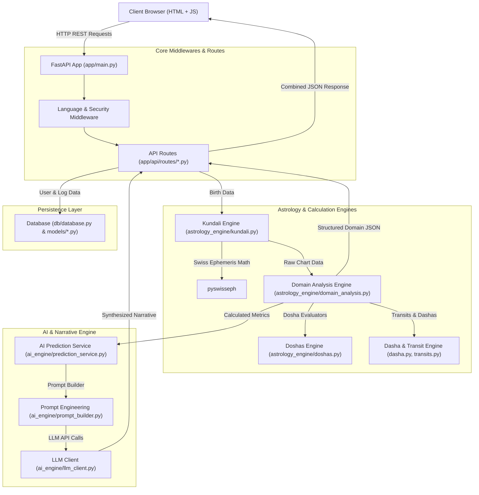

# Astro-Platform Architecture & Complete File Reference Manual

## Executive Summary

The **Astro-Platform** backend is built on **FastAPI**, **Swiss Ephemeris (`swisseph`)**, **SQLAlchemy**, and **LLM Integration (Groq / Gemini)**. It combines high-precision planetary calculations with classical Vedic astrology algorithms and AI-driven predictions.

---

## System Architecture & Data Flow



---

## Comprehensive Directory & File-by-File Details

---

### 1. Root & Configuration Layer (`backend/app/`)

#### `app/main.py`
- **Responsibilities**: Application entry point. Instantiates `FastAPI`, configures CORS middleware, registers request/response logging middleware, mounts static directories, and registers all API routes (`/api/kundali`, `/api/domains`, `/api/panchang`, `/api/horoscope`, `/api/auth`, `/api/blogs`, `/api/admin`, `/api/feedback`).
- **Interrelationships**: 
  - Imports database initialization from `app.db.database`.
  - Imports and mounts routers from `app.api.routes.*`.
  - Imports language middleware from `app.api.middleware.language`.

#### `app/core/config.py`
- **Responsibilities**: Environment variables management using `pydantic-settings`. Configures API keys (Groq, Gemini, OpenAI), database URL, JWT secret keys, CORS origins, and Redis configurations.
- **Interrelationships**: Imported across `db/database.py`, `core/security.py`, `services/ai_engine/llm_client.py`, and `main.py`.

#### `app/core/security.py`
- **Responsibilities**: Password hashing (`passlib` with bcrypt), token creation, and validation (`PyJWT`).
- **Interrelationships**: Used by `services/auth_service.py` and `api/dependencies.py`.

#### `app/core/cache.py`
- **Responsibilities**: Thread-safe in-memory TTL caching with Redis fallback support.
- **Interrelationships**: Used by `panchang.py`, `horoscope.py`, and API routes to cache heavy calculations.

#### `app/core/constants.py`
- **Responsibilities**: Stores system-wide constant values (default coordinates, sign lists, house names, default planetary limits).
- **Interrelationships**: Imported by `astrology_engine` modules and `schemas`.

#### `app/core/logger.py`
- **Responsibilities**: Standardized application-wide logging setup (console + file rotators).
- **Interrelationships**: Used across all services and route handlers.

---

### 2. Database & Data Models (`app/db/` & `app/models/`)

#### `app/db/database.py`
- **Responsibilities**: Manages SQLAlchemy `create_engine`, `sessionmaker`, and `DeclarativeBase`. Supports both SQLite (`astrologic.db`) and PostgreSQL.
- **Interrelationships**: Consumed by `api/dependencies.py` to yield database sessions per API request.

#### `app/models/user.py`
- **Responsibilities**: Defines `User` database table (id, email, hashed_password, full_name, birth_details, is_active, created_at).
- **Interrelationships**: Used by `services/user_service.py` and `services/auth_service.py`.

#### `app/models/admin.py`
- **Responsibilities**: Defines `AdminUser` database table for platform management permissions.
- **Interrelationships**: Used by `api/routes/admin.py`.

#### `app/models/blog.py`
- **Responsibilities**: Defines `BlogPost` model (title, slug, content, language, tags, author, published_at).
- **Interrelationships**: Consumed by `services/blog_service.py` and `api/routes/blogs.py`.

#### `app/models/feedback.py`
- **Responsibilities**: Stores user ratings, testimonials, and system feedback.
- **Interrelationships**: Consumed by `services/feedback_service.py` and `api/routes/feedback.py`.

#### `app/models/activity.py`
- **Responsibilities**: Records user actions and system activity logs for security auditing.
- **Interrelationships**: Written to by route handlers and admin services.

---

### 3. Classical Astrology Engine (`app/services/astrology_engine/`)

This directory forms the mathematical heart of the platform.

#### `astrology_engine/kundali.py`
- **Responsibilities**: Primary birth chart calculation engine. Interfaces directly with `pyswisseph` (Swiss Ephemeris) to compute exact planetary longitudes, house cusps, Lagna (Ascendant), Moon sign, and planetary speeds.
- **Interrelationships**:
  - Consumed by `api/routes/kundali.py` and `domain_analysis.py`.
  - Calls `planets.py`, `houses.py`, `dasha.py`, `navamsa.py`, `doshas.py`, `yogas.py`.

#### `astrology_engine/domain_analysis.py`
- **Responsibilities**: Complete 10 Life Domain Engine (*Marriage, Career, Wealth, Health, Children, Education, Property, Challenges, Travel, Spirituality*).
- **Calculations**:
  - Positional Strength (9-tier dignity system: Exalted, Moolatrikona, Own Sign, Great Friend, Friend, Neutral, Enemy, Great Enemy, Debilitated).
  - Combustion checks (`_is_combust`).
  - Neech Bhanga debilitation cancellation (`_neech_bhanga`).
  - Planetary net strength scoring.
  - Domain score algorithm (Primary houses 40% + Lords 35% + Karakas 25% + D9 bonuses).
  - Marriage type (Arranged vs. Love), partner traits, Manglik cancellation, timing windows.
- **Interrelationships**:
  - Consumes `doshas.py` (`evaluate_mangal_dosha`, `evaluate_pitru_dosha`).
  - Called by `api/routes/prediction.py` and `services/ai_engine/prediction_service.py`.

#### `astrology_engine/doshas.py`
- **Responsibilities**: Contains consolidated dosha evaluation functions:
  - `evaluate_mangal_dosha()`: Checks houses {1, 2, 4, 7, 8, 12} and cancellation rules.
  - `evaluate_pitru_dosha()`: Checks Rahu/Ketu in 9th, Sun in 9th afflicted, Sun conjunct nodes.
  - `calculate_doshas()`: Evaluates Sade Sati, Kaal Sarp, Grahan Dosh, and Gandmool Dosh.
- **Interrelationships**: Imported and shared between `domain_analysis.py` and `api/routes/kundali.py`.

#### `astrology_engine/dasha.py`
- **Responsibilities**: Vimshottari Dasha calculation engine. Calculates 120-year cycle of Mahadasha, Antardasha, and Pratyantardasha periods based on Moon's birth Nakshatra degree.
- **Interrelationships**: Consumed by `kundali.py` and `domain_analysis.py` (`_timing`).

#### `astrology_engine/navamsa.py` & `charts.py`
- **Responsibilities**: Generates D9 Navamsa divisional chart and other Shodashvarga divisional charts (D2, D3, D7, D10, D12, D30).
- **Interrelationships**: Consumed by `domain_analysis.py` for D9 marriage/career adjustments.

#### `astrology_engine/panchang.py`
- **Responsibilities**: Five elements of Panchang (*Tithi, Vaar, Nakshatra, Yoga, Karana*) and Muhurta timings (Rahu Kalam, Yamaganda, Abhijit Muhurta, Gulika Kalam).
- **Interrelationships**: Consumed by `api/routes/panchang.py`.

#### `astrology_engine/transits.py` & `timing.py`
- **Responsibilities**: Calculates Gochara (current real-time planetary transits) and evaluates double transit confluence (Jupiter + Saturn over key houses).
- **Interrelationships**: Consumed by `domain_analysis.py` for timing predictions.

#### `astrology_engine/aspects.py`, `planets.py`, `houses.py`, `strength.py`, `yogas.py`, `zodiac.py`
- **Responsibilities**: Supporting mathematical utilities for Vedic aspects (7th aspect + special Mars 4/8, Jupiter 5/9, Saturn 3/10 aspects), Shadbala strength, and Yoga detection (Raja, Dhana, Gajakesari, Pancha Mahapurusha Yogas).

---

### 4. AI Engine & Narrative Subsystem (`app/services/ai_engine/`)

#### `ai_engine/prediction_service.py`
- **Responsibilities**: High-level coordinator that takes structured domain outputs from `domain_analysis.py`, builds prompts via `prompt_builder.py`, and calls `llm_client.py` to synthesize fluid AI prediction readings.
- **Interrelationships**: Called by `api/routes/prediction.py`.

#### `ai_engine/prompt_builder.py`
- **Responsibilities**: Engineering system prompts and user templates for life domain predictions, daily horoscopes, and AI chat assistant.
- **Interrelationships**: Consumed by `prediction_service.py` and `chat_service.py`.

#### `ai_engine/llm_client.py`
- **Responsibilities**: Unified API client wrapper for Groq / Gemini / OpenAI APIs with automatic fallback and error retry logic.
- **Interrelationships**: Consumed by `prediction_service.py` and `chat_service.py`.

#### `ai_engine/chat_service.py`
- **Responsibilities**: Manages interactive user chat conversations with the AI Astrologer assistant.
- **Interrelationships**: Consumed by user chat endpoint handlers.

---

### 5. API Routes Layer (`app/api/routes/`)

#### `api/routes/prediction.py`
- **Responsibilities**: Exposes POST `/api/domains` endpoint. Accepts birth data, triggers `domain_analysis.analyse_all_domains()`, optionally invokes AI narrative enhancement, and returns JSON payload.

#### `api/routes/kundali.py`
- **Responsibilities**: Exposes POST `/api/kundali` endpoint. Generates birth chart (D1), Navamsa (D9), planetary positions, Dasha timelines, and active doshas.

#### `api/routes/panchang.py`
- **Responsibilities**: Exposes GET/POST `/api/panchang` endpoints for daily Panchang, Muhurtas, and festival calendar.

#### `api/routes/horoscope.py`
- **Responsibilities**: Exposes GET `/api/horoscope/{sign}` for daily zodiac predictions.

#### `api/routes/auth.py`
- **Responsibilities**: Authentication endpoints (POST `/login`, POST `/register`, GET `/me`).

#### `api/routes/blogs.py`, `admin.py`, `feedback.py`, `pages.py`
- **Responsibilities**: Serves blog content, admin dashboard management, feedback submissions, and HTML page rendering.

---

### 6. Templates & Frontend Assets (`app/templates/` & `app/static/`)

#### `templates/prediction.html`
- **Responsibilities**: Interactive UI for Life Domain Predictions. Includes tabbed domain selection (*Marriage, Career, Wealth, Health, etc.*), progress score rings, timing cards, and remedy modal.

#### `templates/kundali.html` & `static/js/kundali.js`
- **Responsibilities**: Interactive SVG North Indian / South Indian birth chart generator and interactive planetary table viewer.

#### `static/locales/*.json` (`en.json`, `hi.json`, `mr.json`, `ta.json`, `te.json`, `kn.json`, `gu.json`, `bn.json`)
- **Responsibilities**: Multi-language translation dictionaries consumed by `i18n.js` and FastAPI backend for instant 8-language support.

---

## End-to-End Execution Sequence for `/api/domains`

```
1. User submits birth form on prediction.html
   │
2. POST request received by app/api/routes/prediction.py
   │
3. Route parses input & calls app/services/astrology_engine/kundali.py
   │  └─► Calls swisseph for planetary longitudes, houses & D9 chart
   │
4. Chart output passed to domain_analysis.analyse_all_domains(chart)
   │  ├─► _build_ctx(): computes net scores, dignities & yogas
   │  ├─► Calls evaluate_mangal_dosha() & evaluate_pitru_dosha() from doshas.py
   │  ├─► Computes domain score & narrative for all 10 life domains
   │  └─► Evaluates Dasha + Transit timing windows
   │
5. (Optional) Structured result passed to ai_engine/prediction_service.py
   │  └─► Formats prompt via prompt_builder.py & calls llm_client.py
   │
6. Unified prediction response JSON returned to frontend JS for rendering.
```
